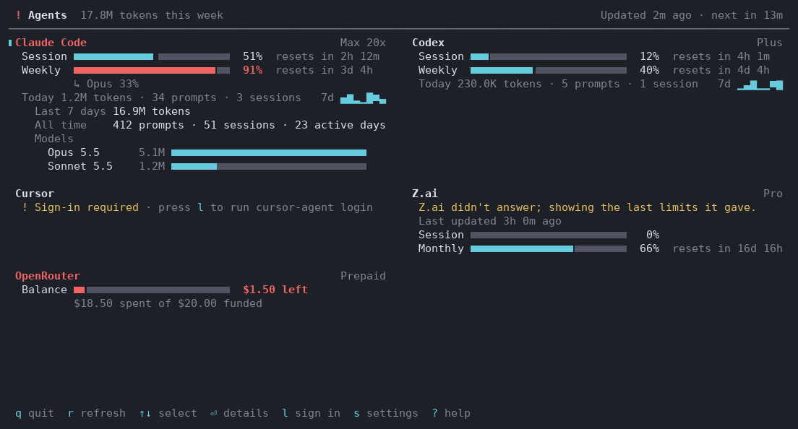

# agents-tui

A terminal panel for your AI coding subscriptions, in the spirit of htop and btop: each provider's rate limits, when they reset, prepaid balances, and what your token counts add up to. It runs in any terminal on macOS and Linux.



It covers every provider Omarchy's agents panel knows (Claude Code, Codex, Cursor, OpenCode, Copilot, Grok, Kimi, Z.ai, OpenRouter, DeepSeek, Ollama, local models and more). A provider's card appears once you've used it or signed in to it on this machine.

## How it works

It's the terminal sibling of [agents-macos](https://github.com/xbonell/agents-macos), and both port [Omarchy](https://github.com/omacom/omarchy)'s `omarchy.agents` panel the same way:

- **Collectors** are Omarchy's own Python scripts, vendored unmodified in `vendor/omarchy/`. Each prints one JSON record (the format is Omarchy's [`docs/agent-usage-collectors.md`](https://github.com/omacom/omarchy/blob/HEAD/docs/agent-usage-collectors.md)), reading the agent's local logs and asking its usage endpoint with the credentials its CLI already saved. Credentials are only ever read.
- **`runner/run_collector.py`** runs one. On Linux the collectors run as Omarchy ships them. On macOS it applies `runner/macos_shim.py`, which reads Claude Code's and cursor-agent's tokens from the Keychain and finds Cursor's editor database under `~/Library`, and gives older Pythons the vendored `tomli` as `tomllib`.
- **agents-tui** runs the collectors in parallel, writes each record atomically to its usage folder, and draws the panel with Python's built-in `curses`. Refresh timing is Omarchy's: every 15 minutes, every 3 minutes near an account's switch threshold, and a 30-second retry for an agent whose endpoint couldn't be reached.

Nothing needs installing from pip.

## Requirements

- Python 3.9 or later with `curses`. macOS's own `/usr/bin/python3` (from Apple's Command Line Tools, `xcode-select --install`) works, as does any current Linux distribution's `python3`. A few minimal distributions package curses separately.
- [ripgrep](https://github.com/BurntSushi/ripgrep) (`rg`), which the collectors use to find local session logs.
- The agents' own CLIs, signed in as you normally use them.

## Install

```sh
git clone https://github.com/xbonell/agents-tui.git
cd agents-tui
./install.sh            # links agents-tui into ~/.local/bin; PREFIX=/usr/local ./install.sh for elsewhere
agents-tui
```

The installer only makes a symlink, so `git pull` updates it and `./install.sh --uninstall` removes it. You can also run `bin/agents-tui` straight from the clone.

## Using it

| Key | |
|---|---|
| `↑ ↓ ← →`, `j k` | Select a card |
| `Enter`, `Space` | The selected card's details: last 7 days, all-time totals, tokens by model, accounts |
| `e` | Every card's details |
| `r` | Refresh every collector now, reusing nothing |
| `l` | Sign the selected agent in: pauses the panel and runs `claude auth login`, `codex login`, `cursor-agent login` (Cursor and Grok Bot), `opencode auth login` or `grok login` right there |
| `s` | Settings: refresh interval, notifications, which providers to collect |
| `?` | Help, and where its files are |
| `PgUp PgDn`, `g G` | Scroll |
| `q` | Quit |

Cards sit side by side when the terminal is wide enough, and the layout narrows down to about 30 columns. A meter turns red at 90%, and so does the `!` in the header. When a limit reaches 90% (or a prepaid balance its last 10%), agents-tui beeps and sends a desktop notification once per window: through Notification Center on macOS, and `notify-send` on a Linux desktop.

Block characters are used with a UTF-8 locale, plain `#-` meters otherwise; `NO_COLOR` is respected. `--ascii` and `--no-color` force either.

### Other commands

```sh
agents-tui print [--details] [--width N] [--refresh]   # the panel once, for scripts or a quick look
agents-tui status                     # one line, e.g. for a tmux status bar:
                                      # Claude Code 91% · Codex 40% · Cursor sign-in
agents-tui json [--all]               # the records as a JSON array
agents-tui collect [--force|--limits-only] [--notify] [id...]   # run collectors, e.g. from cron
agents-tui providers                  # every collector, and whether it's on and in use
agents-tui doctor                     # checks Python, rg, the CLIs, and what each collector found
```

For tmux: `set -g status-right '#(agents-tui status)'`, with a cron job or the TUI running to keep the records fresh.

## Settings

`~/.config/agents-tui/config.toml` (or under `$XDG_CONFIG_HOME`). The settings screen writes it; every key is optional:

```toml
refresh_interval = 900     # seconds, 30 to 3600
disabled = ["local"]       # providers not to collect or show
notify = true              # bell and desktop notification at 90%
usage_dir = ""             # read records from elsewhere (see below)
collect = true             # false: only display records, never run collectors
ascii = "auto"             # auto, always, never
color = "auto"
```

### Sharing records with agents-macos or Omarchy

If agents-macos or Omarchy's panel already collects on this machine, agents-tui can display their records instead of collecting a second time:

```toml
# macOS, with agents-macos
usage_dir = "~/Library/Application Support/Agents/omarchy/agents/usage"
collect = false

# Omarchy
usage_dir = "~/.local/state/omarchy/agents/usage"
collect = false
```

Or try it for one run: `agents-tui --usage-dir <dir> --no-collect`.

## Where things live

| | macOS | Linux |
|---|---|---|
| Records | `~/Library/Application Support/agents-tui/usage/` | `~/.local/state/agents-tui/usage/` |
| Collector caches | `~/Library/Caches/agents-tui/omarchy/agent-usage/` | `~/.cache/omarchy/agent-usage/` (shared with Omarchy, whose caches are written under locks) |
| Collector failures | `~/Library/Caches/agents-tui/collect.log` | `~/.cache/agents-tui/collect.log` |
| Notifications sent | `~/Library/Application Support/agents-tui/notified.json` | `~/.local/state/agents-tui/notified.json` |

Linux paths follow `XDG_STATE_HOME` and `XDG_CACHE_HOME` when set.

## Privacy

- Credentials are only ever read, never written or refreshed: from each agent's own files, and on macOS from the Keychain for Claude Code and cursor-agent (macOS may ask once to allow it).
- Each collector sends its credential only to its own provider's usage endpoint (Anthropic, Cursor, OpenRouter, and so on; local models are asked on `127.0.0.1`). agents-tui itself makes no network requests.
- Records, caches and logs stay on your machine, in the folders above. There's no telemetry or analytics.

## Updating the collectors from Omarchy

The vendored collectors are copies, and Omarchy changes them often. Every `bin/omarchy-agent-usage-*` collector is vendored, so a provider Omarchy adds arrives with the next sync.

1. `scripts/check-upstream.sh --fetch [omarchy-checkout]` lists the vendored files that differ from the checkout's tracked branch (clone [omacom/omarchy](https://github.com/omacom/omarchy) anywhere and pass its path or set `OMARCHY_CHECKOUT`; the default is `~/Work/99.misc/omarchy`), and the upstream commits that touched them since the last sync. It never changes the checkout. `--ref <ref>` compares with any ref.
2. Update the checkout (`git pull`), then `scripts/sync-upstream.sh [omarchy-checkout]` copies them over and records the revision in `vendor/omarchy/UPSTREAM_REVISION`.
3. Run the tests and `agents-tui doctor`.

A change that breaks on macOS gets its fix in `runner/macos_shim.py`, never in the vendored files.

## Development

```sh
python3 -m unittest discover -s tests -t .                  # every test, including the real collectors and a pty-driven TUI
bin/agents-tui --usage-dir tests/fixtures --no-collect      # the TUI on sample records
python3 -I runner/run_collector.py claude --force           # one collector's record
```

## Not ported yet

Registering several accounts per provider and switching between them (records from Omarchy that carry accounts are shown), the add-subscription flow, launching an agent from the panel, and cross-device sync.

## Contributing

Issues and pull requests are welcome; [CONTRIBUTING.md](CONTRIBUTING.md) has the ground rules, and [AGENTS.md](AGENTS.md) explains how it's put together.

## License

MIT, see [LICENSE](LICENSE), which also credits Omarchy (the collectors and the panel's design and logic) and tomli.
